

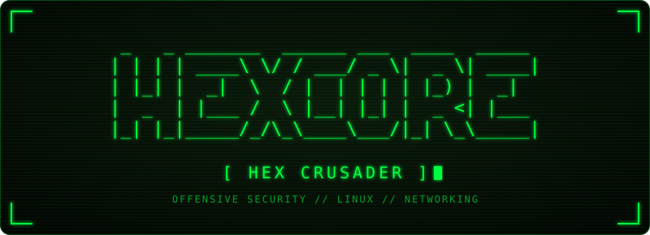

 

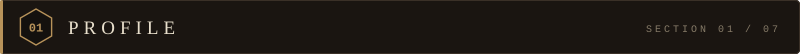

> **Offensive Security Operations · Detection Engineering**

Building a strong foundation in **Linux, networking, programming, and offensive security**, with a focus on **penetration testing and red teaming**, and the detection engineering that closes the loop: turning every attack path into something defenders can see, alert on, and stop. Growing interest in **exploit development, malware analysis, and cryptography**.

 

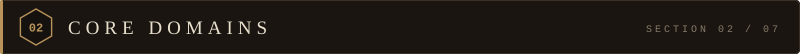

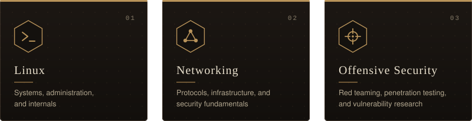

 

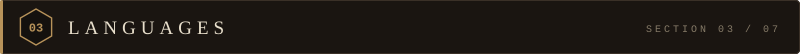

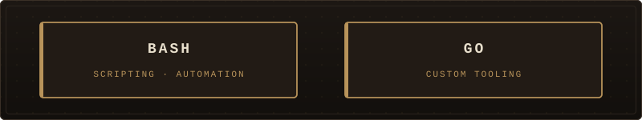

**Bash** for scripting and automation. **Go** for writing custom tools.

 

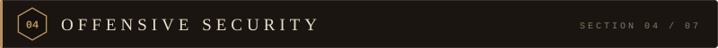

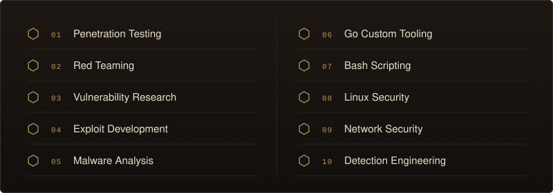

 

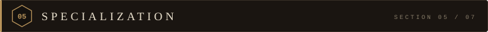

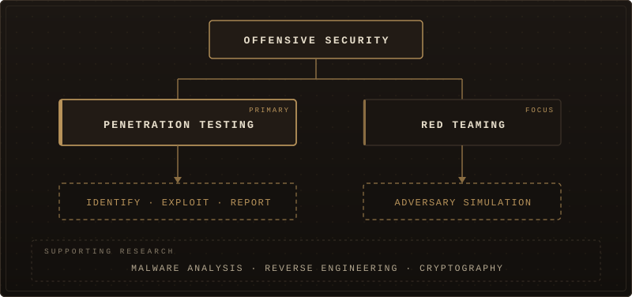

**Primary focus:** penetration testing (identify, exploit, report).
**Also:** red teaming and adversary simulation.
**Supporting research:** malware analysis, reverse engineering, and cryptography.

 

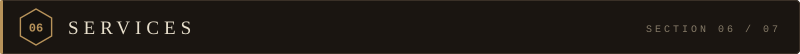

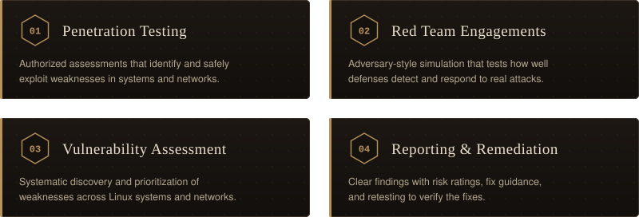

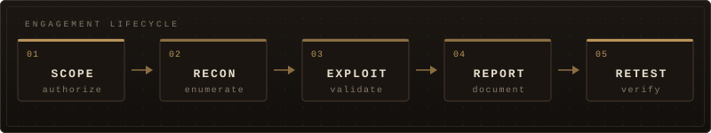

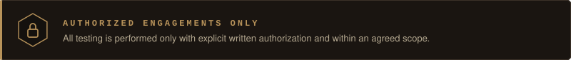

To discuss an engagement, reach out through the contact links on this profile.

 

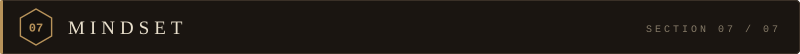

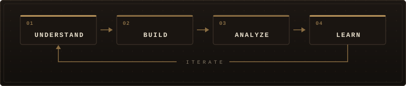

 

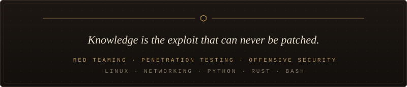
